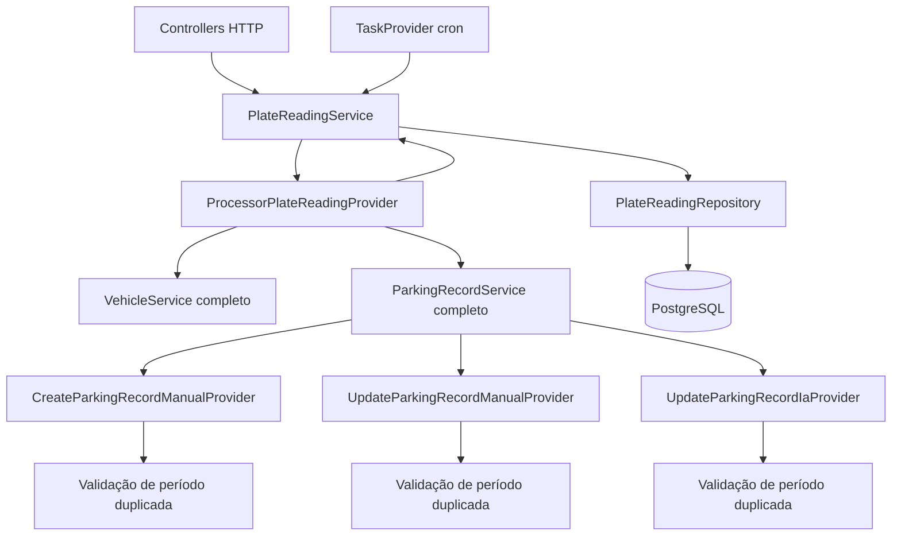
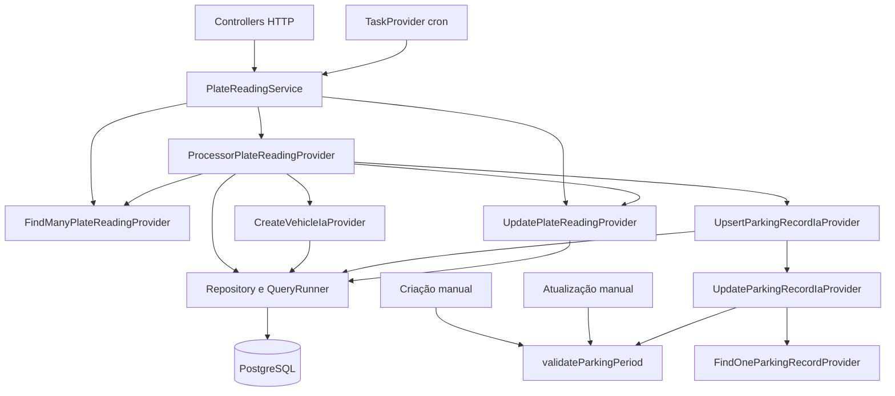

# 04 — Arquitetura e dependências

O sistema mantém NestJS, módulos por domínio, DTOs, entidades e repositories TypeORM. Os diagramas mostram **o recorte refatorado**, não todos os módulos da API.

## Antes

O processador acessava `service.findMany`, `service.update`, `vehicleService.createIa` e `parkingRecordService.upsertIa`. Providers também recebiam a fachada que os construía, formando imports de volta para os serviços.

## Depois

## Direção, montagem e limites

Controllers e cron continuam usando os serviços públicos; a API dessas fachadas é preservada. Os serviços montam os providers existentes com `new`, seguindo a arquitetura original. Não foi introduzido um segundo container de DI nem uma interface por operação. Dentro dos providers alterados, os colaboradores agora são as operações específicas utilizadas.

Nest injeta serviços e repositories. `findOne`, `findMany`, atualização e criação são construídos antes dos providers que precisam deles. O `forwardRef` de **injeção de serviço** em `ParkingRecordService` era desnecessário: o grafo de construtores é `ParkingRecordService -> VehicleService -> CustomerService`, sem dependência de volta. Ele foi removido após o smoke real detectar uma fachada inicializada parcialmente. Os `forwardRef` nos **módulos** continuam existentes, pois os módulos também agrupam controllers e outras dependências.

Os providers de domínio ainda importam infraestrutura e DTOs/entidades do projeto. Não se afirma uma implementação completa de arquitetura hexagonal ou inversão de dependências. Outros providers fora do recorte continuam recebendo fachadas; não houve reescrita ampla.

## Transações e testabilidade

Cada leitura segue em ordem: localizar/criar veículo, abrir/fechar estacionamento se `isServiceVehicle === false`, e marcar as leituras ao final. O mesmo QueryRunner é propagado no lote. A seleção inicial das leituras e a consulta de marcação mantêm suas posições originais em relação à transação; não se introduz uma promessa nova de isolamento.

O helper de período pode ser exercitado pelas operações sem banco. Os providers recebem colaboradores menores, simplificando os doubles. O teste com `Test.createTestingModule` verifica a inicialização real; a demo complementa a prova com PostgreSQL, migrations e HTTP.

## Métricas estáticas

O [script de arquitetura](../scripts/architecture-report.cjs) conta imports locais de TypeScript, **incluindo imports de tipos**, com uma aresta por par de arquivos. Fan-in é a quantidade de arquivos que importam o arquivo; fan-out é a quantidade de arquivos locais importados. Instabilidade = fan-out / (fan-in + fan-out), ou zero sem arestas. Essas métricas são aproximações estruturais; não medem todas as chamadas nem demonstram ciclos de DI em runtime.

| Arquivo                               | Fan-in antes/depois | Fan-out antes/depois | Instabilidade antes/depois |
| ------------------------------------- | ------------------- | -------------------- | -------------------------- |
| `parking-record.service.ts`           | 9 / 4               | 9 / 9                | 0.5 / 0.692                |
| `vehicle.service.ts`                  | 12 / 9              | 8 / 8                | 0.4 / 0.471                |
| `plate-reading.service.ts`            | 4 / 3               | 6 / 6                | 0.6 / 0.667                |
| `processor-plate-reading.provider.ts` | 1 / 1               | 5 / 6                | 0.833 / 0.857              |

Global: **611 para 610 arestas** e **sete para seis componentes fortemente conectados** com ciclos. Há ciclos remanescentes, inclusive relações de entidades e dependências fora do recorte. Mais imports explícitos em um provider não implicam maior dependência das fachadas; por isso o fan-out do processador cresce de cinco para seis enquanto os acessos ficam explícitos.

## Evidências

- [Grafo, ciclos e métricas por arquivo](../reports/architecture.json), [montagem real testada](../test/service-wiring.spec.ts) e [comparação real](../reports/demo-comparison.json).
- [PR 3](https://github.com/Plate-Vision/plate-vision-api/pull/29), [PR 4](https://github.com/Plate-Vision/plate-vision-api/pull/30) e [helper](../src/modules/parking-record/domain/services/helpers/validate-parking-period.ts).
- `node scripts/architecture-report.cjs`; `npm test -- test/service-wiring.spec.ts`.

## Roteiro de 1 minuto

Compare as setas do processador antes/depois. Explique a diferença entre fachadas públicas, providers internos e DI do Nest. Mostre a remoção do `forwardRef` de serviço e o teste que a protege. Mostre as métricas e diga explicitamente que seis componentes cíclicos de imports permanecem.
